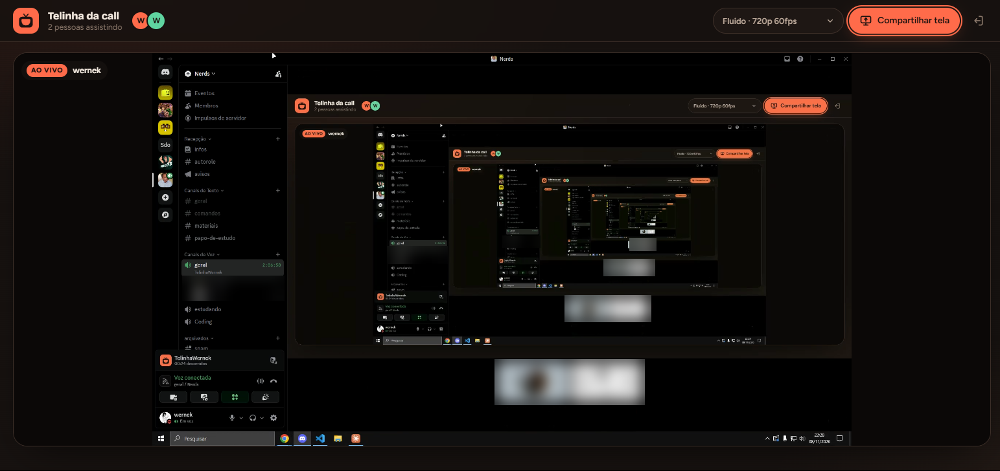

<p align="center">
  
</p>

<h1 align="center">Telinha</h1>

<p align="center">
  Compartilhamento de tela que roda <b>dentro do Discord</b>, como Atividade, igual aos jogos do 🚀.<br/>
  Projeto open source: hospede o seu e use com a sua galera.
</p>

<p align="center">
  
</p>

---

## O que ele faz

- **Roda embutido na call:** abre pelo menu de Atividades do canal de voz, sem sair do Discord.
- **Sala automática:** todo mundo no mesmo canal de voz cai na mesma sala, sem link nem configuração.
- **Login pelo Discord:** cada um aparece com o próprio nome.
- **Até 1080p a 60 FPS.** Tem um seletor de qualidade para escolher entre fluidez e nitidez.
- **Som do jogo ou do vídeo, sem a call junto:** o som vai por janela (o jogo) ou por aba (um vídeo). O som do PC inteiro nunca é capturado, porque ele levaria a voz da call do Discord e a galera se ouviria de volta.
- **Mudo e volume** em cada transmissão. Sua própria transmissão começa no mudo, para você não se ouvir.
- **Tela cheia** dentro da Atividade (Esc ou duplo clique para sair).
- **Também funciona fora do Discord,** como um site normal: você cria uma sala e manda o link.

### Qualidades disponíveis

| Opção | Resolução | FPS | Bom para |
|---|---|---|---|
| **Fluido** (padrão) | 720p | 60 | jogos e vídeos |
| Equilibrado | 1080p | 30 | um pouco de tudo |
| Máximo | 1080p | 60 | PC e internet bons |
| Texto nítido | 1080p | 30 | código e documentos |

---

## Como funciona

```
Quem compartilha ──(WebRTC)──▶ LiveKit Cloud ──▶ Quem assiste
        ▲                                             ▲
        └──── Atividade do Discord (iframe) ──────────┘
                      │
                      ▼
          Servidor do Telinha (Vercel)
          • entrega a página
          • gera os tokens do LiveKit
          • troca o login do Discord (OAuth2)
```

- **LiveKit Cloud** transporta o vídeo. O plano grátis dá para uso entre amigos.
- **Servidor do Telinha:** um Express pequeno (`server.js`) que não guarda estado nenhum, por isso roda bem na Vercel.
- **Discord:** carrega o site num iframe pelo proxy dele (`<id>.discordsays.com`). O LiveKit também passa por esse proxy, via o mapeamento `/livekit`.

---

## Como hospedar o seu

Você vai precisar de:

- uma conta no [GitHub](https://github.com);
- uma conta no [LiveKit Cloud](https://cloud.livekit.io) (grátis);
- uma conta na [Vercel](https://vercel.com) (grátis);
- uma conta do Discord e um servidor onde você possa adicionar apps.

São uns 15 minutos. Siga na ordem.

### 1. Copie o projeto

Faça um **fork** deste repositório no GitHub, ou clone e suba no seu próprio repositório.

### 2. LiveKit (o vídeo)

1. Entre em [cloud.livekit.io](https://cloud.livekit.io) e crie um projeto.
2. Vá em **Settings → Keys** e crie uma chave.
3. Anote os três valores:
   - **WebSocket URL**, algo como `wss://meu-projeto-abc123.livekit.cloud`;
   - **API Key**;
   - **API Secret**, que só aparece uma vez.

### 3. App no Discord

1. Entre no [Discord Developer Portal](https://discord.com/developers/applications) e clique em **Novo aplicativo**. Dê um nome, que é o nome que aparece no menu de Atividades.
2. Em **Informações gerais**, você pode subir o ícone `design/telinha-icone-1024.png`. Anote o **ID do aplicativo** (é o Client ID).
3. Em **OAuth2**:
   - clique em **Redefinir segredo** e anote o **Client Secret**;
   - em **Redirecionamentos**, adicione `https://127.0.0.1` e salve. O SDK exige um redirect cadastrado, mesmo sem usar.

> A **Chave pública** da página inicial não é usada. O secret é só o do OAuth2.

### 4. Deploy na Vercel

1. Na Vercel, clique em **Add New → Project** e importe o seu repositório.
2. A Vercel detecta tudo sozinha: o build roda `npm run build` e o servidor é o `server.js`.
3. Em **Environment Variables**, adicione:

   | Variável | Valor |
   |---|---|
   | `LIVEKIT_URL` | o WebSocket URL do passo 2 |
   | `LIVEKIT_API_KEY` | a API Key do passo 2 |
   | `LIVEKIT_API_SECRET` | o API Secret do passo 2 |
   | `DISCORD_CLIENT_ID` | o ID do aplicativo do passo 3 |
   | `DISCORD_CLIENT_SECRET` | o Client Secret do passo 3 |
   | `PUBLIC_URL` | a URL do seu deploy, ex: `https://meu-telinha.vercel.app` |
   | `CODIGO_ACESSO` | *(opcional)* senha para quem entra pelo navegador |

4. Clique em **Deploy**. Se você só descobrir a URL depois do primeiro deploy, preencha a `PUBLIC_URL` e faça um **Redeploy**, porque a Vercel só aplica variáveis novas num deploy novo.

Para testar, abra `https://<seu-deploy>/api/config`. A resposta deve mostrar o seu `discordClientId` e a `publicUrl`.

### 5. Configurar a Atividade no Developer Portal

Faça **nesta ordem**: o Discord só deixa ligar as Atividades depois que o mapeamento existe.

**5.1 Mapeamentos de URL** (menu lateral → **Atividades → Mapeamentos de URL**)

| Campo | Prefixo | Alvo |
|---|---|---|
| Mapeamento de raízes | `/` | `meu-telinha.vercel.app` |
| Clique em **Adicione outro mapeamento de URL** | `/livekit` | `meu-projeto-abc123.livekit.cloud` |

- No **alvo**, coloque **só o domínio**: sem `https://`, sem `wss://` e sem `/` no final.
- O alvo do `/livekit` é o seu `LIVEKIT_URL` sem o `wss://`.
- Clique em **Salvar alterações** (a barra que aparece embaixo da página).

**5.2 Ligar as Atividades** (menu lateral → **Atividades → Configurações**)

- Ative **Ativar atividades** e salve.
- Se a chave estiver cinza com o aviso "Requisito necessário: mapeamento de URL", o passo 5.1 não foi salvo.

**5.3 Configurar a instalação** (menu lateral → **Instalação**)

- Em **Contextos de instalação**, marque **Instalação no servidor** (Guild Install) e **Instalação do usuário** (User Install).
- Em **Link de instalação**, deixe **Link fornecido pelo Discord**.
- Em **Configurações de instalação padrão → Instalação no servidor**, adicione o escopo `applications.commands`. Não precisa do escopo `bot` nem de permissões.
- Salve e **copie o link de instalação**. Ele é parecido com `https://discord.com/oauth2/authorize?client_id=...`.

### 6. Adicionar o app ao seu servidor

1. Abra o **link de instalação** no navegador, já logado no Discord.
2. Escolha **Adicionar ao servidor** e selecione o servidor. Você precisa da permissão **Gerenciar servidor** nele.
3. Autorize.

O app agora aparece em **Configurações do servidor → Integrações**.

> **Para outros servidores:** mande o mesmo link para o dono ou um admin do servidor e peça para ele fazer estes três passos.

### 7. Abrir a Atividade na call

1. **Recarregue o Discord** antes da primeira vez (**Ctrl+R**, ou feche e abra o app). Sem isso, o Discord muitas vezes não enxerga o app recém-instalado.
2. Entre num **canal de voz** do servidor.
3. Na barra de controles da call, clique no ícone de **Atividades** (o foguete 🚀).
4. Procure o seu app pelo nome. **Se a busca não encontrar,** role a lista: ele costuma aparecer numa seção própria do servidor, separada dos jogos oficiais.
5. Clique no app. Na tela que abre:
   - **deixe desmarcado** "Usar permissão especial do URL da atividade", que é só para desenvolvimento;
   - clique em **Executar**, não em "Executar na DM".
6. Na primeira vez, o Discord pede para **autorizar** o app. Aceite.
7. A Atividade abre mostrando **"Telinha da call"** no topo.

Outro jeito de abrir: digite `/` no chat do servidor e procure o comando do app (o Discord cria um comando de abertura automaticamente quando as Atividades são ligadas).

### 8. Compartilhar e assistir

1. Escolha a qualidade no seletor (**Fluido · 720p 60fps** para jogos).
2. Clique em **Compartilhar tela** e escolha a tela ou janela.
   - Para mandar o **som de um jogo**, escolha a aba **Janela** e a janela do jogo. Precisa do Chrome 141 ou mais novo.
   - Para mandar o **som de um vídeo ou site**, escolha uma **aba** do Chrome e marque "Compartilhar áudio da aba".
   - **Tela inteira vai sem som**, de propósito: o som do PC inteiro incluiria a call do Discord.
   - Se o Discord bloquear a captura, ele pergunta se pode **abrir um link no navegador**. Aceite e compartilhe por lá: a tela aparece dentro da Atividade do mesmo jeito.
3. **Quem vai assistir:** basta entrar na mesma call e abrir a mesma Atividade (passos 3 a 6 do item 7). Quem já está nela aparece como ícone em cima da call, e dá para clicar para entrar.
4. Tela cheia: botão no canto do vídeo ou **duplo clique**. Para sair, **Esc**.

### Checklist rápido

Use quando algo não funcionar:

- [ ] `https://<seu-deploy>/api/config` abre e mostra o seu `discordClientId` e a `publicUrl` certa
- [ ] O redirect `https://127.0.0.1` está salvo no OAuth2
- [ ] Os dois mapeamentos (`/` e `/livekit`) estão salvos, sem `https://` ou `wss://`
- [ ] **Ativar atividades** está ligado
- [ ] O app foi adicionado ao servidor pelo link de instalação
- [ ] O Discord foi recarregado (Ctrl+R) depois de instalar ou atualizar

---

## Rodar no seu PC (desenvolvimento)

```bash
npm install
cp .env.example .env
npm start
```

Preencha o `.env` antes de rodar. O app abre em http://localhost:3000. Fora do Discord, basta um nome e uma sala.

Para testar **dentro do Discord** sem fazer deploy, crie um túnel HTTPS temporário:

```bash
cloudflared tunnel --url http://localhost:3000
```

Use a URL `https://...trycloudflare.com` que aparecer no mapeamento `/` do portal e na `PUBLIC_URL` do `.env`, e reinicie o `npm start`. A URL muda toda vez que o túnel reinicia.

### Estrutura

| Caminho | O que é |
|---|---|
| `server.js` | Express: página, `/api/token` (LiveKit), `/api/discord/token` (OAuth2), `/api/config` |
| `src/app.js` | front-end: sala, compartilhamento, qualidade, integração com o Discord |
| `public/` | HTML, CSS, fontes e ícones (o `app.js` é gerado pelo build) |
| `scripts/versionar.js` | coloca `?v=<hash>` nos links do `index.html` para o Discord não usar cache velho |
| `design/` | ícone (SVG e PNG 1024) e conceitos |

---

## Problemas comuns

**O app não aparece no menu de Atividades**
- Confira se **Ativar atividades** está ligado e salvo no portal.
- O app precisa estar **instalado no servidor** pelo link de instalação.
- Recarregue o Discord com **Ctrl+R**. Às vezes o app não aparece na busca, mas está mais embaixo na lista.

**Layout quebrado ou versão antiga dentro do Discord**
- O Discord guarda cache. Feche a Atividade, aperte **Ctrl+R** e abra de novo.

**"Não deu para ligar a telinha" ao abrir a Atividade**
- Confira o `DISCORD_CLIENT_ID` e o `DISCORD_CLIENT_SECRET` na Vercel e o redirect `https://127.0.0.1` no OAuth2.
- Confira o mapeamento `/livekit`: precisa ser o host exato do `LIVEKIT_URL`, sem `wss://`.

**Ao compartilhar, abre uma página de erro no navegador**
- A `PUBLIC_URL` está errada ou desatualizada. Corrija na Vercel e faça **Redeploy**.

**O som do jogo não vai**
- Compartilhe a **janela** do jogo, não a tela inteira. A tela inteira vai sem som de propósito.
- O som por janela precisa do Chrome 141 ou mais novo. Se estiver compartilhando por dentro do Discord e não funcionar, compartilhe pelo Chrome.

**Eco ou me ouvindo de volta**
- Não deixe uma segunda janela do Telinha aberta **no mesmo PC** tocando a sua transmissão. Se ela foi aberta pela Atividade, já começa no mudo; senão, use o botão de mudo no vídeo.

**Travando ou com pouco FPS**
- Use **Fluido · 720p 60fps**.
- Não compartilhe o próprio Discord, porque o efeito de espelho infinito pesa muito.
- Se só um amigo trava, provavelmente é a internet dele. O app baixa a resolução automaticamente para manter o FPS.

---

## Licença

[MIT](LICENSE): use, modifique e hospede à vontade, inclusive no seu servidor. Só mantenha o aviso de copyright.

## Feito com

[LiveKit](https://livekit.io) · [Discord Embedded App SDK](https://github.com/discord/embedded-app-sdk) · [Express](https://expressjs.com) · [esbuild](https://esbuild.github.io) · fontes [Bricolage Grotesque](https://fonts.google.com/specimen/Bricolage+Grotesque) e [Figtree](https://fonts.google.com/specimen/Figtree) (OFL)
